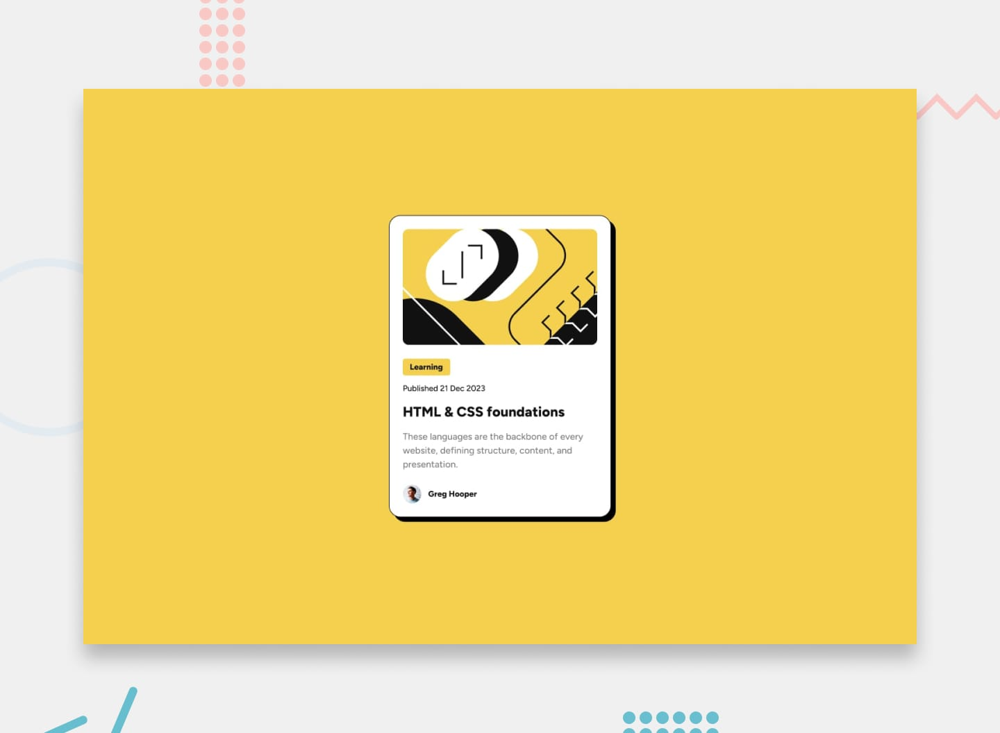

# Frontend Mentor - Blog Preview Card Solution

This is my solution to the Blog Preview Card challenge on Frontend Mentor.

## Overview

### The Challenge

Users should be able to:

- View the blog preview card
- See hover states for interactive elements
- View a responsive layout across different screen sizes

### Screenshot



### Links

- Solution URL: https://www.frontendmentor.io/
- Live Site URL: https://your-live-site-url.com

## My Process

### Built With

- Semantic HTML5
- CSS Flexbox
- Responsive Design
- Custom Fonts using `@font-face`

### What I Learned

While building this project, I practiced:

- Structuring content using semantic HTML
- Centering elements with Flexbox
- Creating reusable CSS classes
- Working with spacing using `padding`, `gap`, and `margin`
- Loading local fonts using `@font-face`
- Making components idth`

Example:

```css
.card {
    width: 100%;
    max-width: 384px;
}
```

## Continued Development

I want to continue improving my:

- CSS layout skills
- Responsive design techniques
- Understanding of Flexbox
- Git and GitHub workflow

## Author

- Frontend Mentor - @Pryassin
- GitHub - https://github.com/Pryassin

## Acknowledgments

Thanks to the Frontend Mentor community for providing practical projects that help improve front-end development skills.

## Links

- Repository URL: https://github.com/Pryassin/blog-preview-card
- Live Site URL: https://pryassin.github.io/blog-preview-card/
